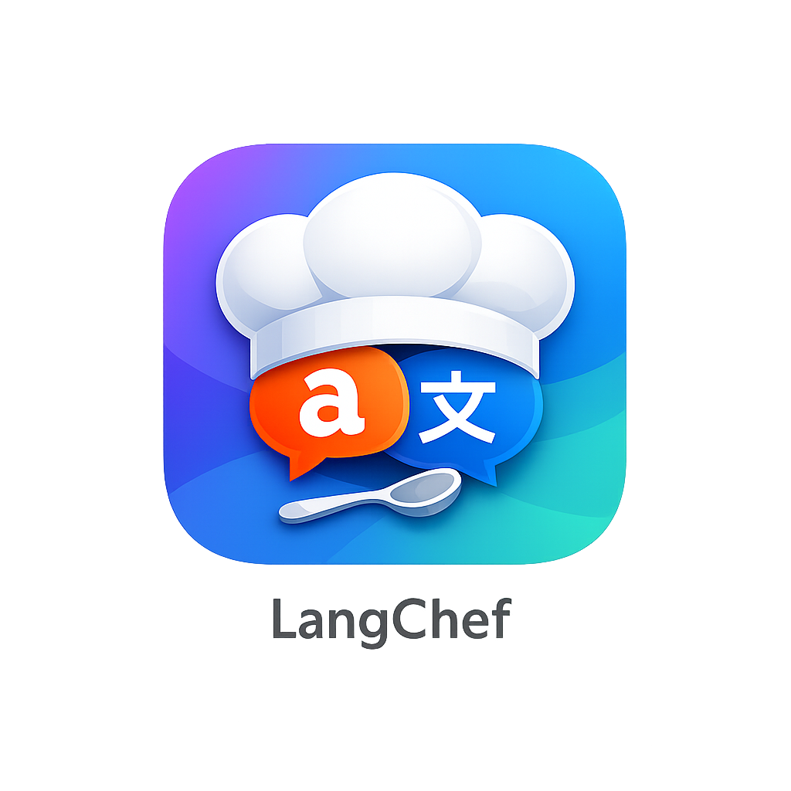

<p align="center"></p>

# LangChef

Learn Japanese or Indonesian by chatting with an AI, with spaced-repetition review of the words and grammar you meet. The app runs in English or Bahasa Indonesia, so someone who reads only Indonesian can learn Japanese.

Available for macOS (Apple Silicon and Intel) and Android (arm64).

## Install

### macOS

Open Terminal and run:

```bash
curl -fsSL https://raw.githubusercontent.com/adzimzf/LangChef/main/scripts/install.sh | bash
```

This downloads the latest release for your Mac, checks it against its checksum and installs `LangChef.app` in `/Applications` (or `~/Applications` if you can't write to `/Applications`). The release isn't notarized by Apple, so the script also removes the download quarantine and signs the app for your Mac. You can then open it normally from Launchpad.

### Android

Download `LangChef_<version>_android_arm64.apk` from the [latest release](https://github.com/adzimzf/LangChef/releases/latest) on your phone and open it. Android asks you to allow installing apps from your browser or file manager the first time.

Or, from a computer with [Android platform-tools](https://developer.android.com/tools/releases/platform-tools) (`adb`) and the phone connected with USB debugging on:

```bash
curl -fsSL https://raw.githubusercontent.com/adzimzf/LangChef/main/scripts/install.sh | bash -s -- --android
```

Without a connected phone, the APK is saved to `~/Downloads` so you can copy it over.

### First run

LangChef needs an AI provider. On first launch it asks for your language, what you want to learn, and an API key (OpenRouter is the default; any OpenAI-compatible API works).

## Update

Run the same command again. It does nothing when you already have the latest version. Your data is kept: cards, chats and settings on macOS live in `~/.app-data/langchef`, and on Android in the app's storage. Use Google Drive sync in Settings to keep devices in step.

On Android you can also install a newer APK over the old one.

## Installer options

Pass options after `bash -s --`, for example `... | bash -s -- --check`:

| Option | What it does |
|--------|--------------|
| `--android` | Install on a phone connected with adb instead of this Mac |
| `--version v1.0.2` | Install a specific release instead of the latest |
| `--dir PATH` | macOS: install `LangChef.app` in another folder |
| `--check` | Only say whether an update is available (exit code 0 = up to date, 10 = update available) |
| `--force` | Reinstall even if this version is installed; allows going back to an older version |

If GitHub's limit on anonymous requests gets in the way, set `GITHUB_TOKEN` before running the script.

## Uninstall

- **macOS:** delete `/Applications/LangChef.app`. To remove your data too, delete `~/.app-data/langchef`.
- **Android:** uninstall it like any other app. This deletes its data, so sync to Google Drive first if you want to keep it.

## Building from source

See [CLAUDE.md](CLAUDE.md) for the architecture and commands. In short:

```bash
git clone --recurse-submodules https://github.com/adzimzf/LangChef
cd LangChef
npm install
GOOGLE_CLIENT_ID=... GOOGLE_CLIENT_SECRET=... npm run tauri:dev
```
